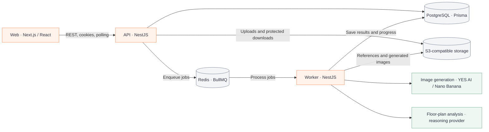

# Roomvi

[Русский](README.md) · **English**

Roomvi is an interior design platform built around real furniture from supplier catalogs. Users provide room dimensions, a style and a budget, explore design variants, and move from an interior visualization to furniture selection and checkout.

An internal B2B workspace supports furniture collection presentations and room visualizations based on property developers’ floor plans.

## Features

- **Interior design.** Room dimensions, an optional photo, style and budget; background generation of multiple design variants with progress tracking.
- **Furniture catalog.** Supplier products, filters, product details and furniture selection for interiors.
- **Shopping.** Cart, checkout, order history and administrative order management.
- **Accounts and access.** Registration, authentication, guest sessions and separate customer, manager and administrator roles.
- **B2B furniture collections.** Partner projects, catalog selection, visualization generation and image downloads.
- **B2B property developers.** Raster floor-plan uploads, room analysis, geometry review by a manager and room interior generation.

**Project status: closed. Active development has ended.** This repository preserves the last implementation of the platform. Production supplier synchronization, payment acquiring and logistics were not completed.

## Interface

Screenshots of the running local application. The catalog uses the bundled demo data; the design and B2B projects were prepared to demonstrate the interface. The interior image on the design screen is a sample reference, not the output of a new generation request. Screenshots show the Russian interface.


| Design wizard: style selection and project brief | Furniture catalog: search, filters and products |
| --- | --- |
| [](assets/screenshots/02-design-wizard.png) | [](assets/screenshots/03-catalog.png) |
| **Design details: interior, products and pricing** | **B2B workspace: partner project and product selection** |
| [](assets/screenshots/04-design-details.png) | [](assets/screenshots/05-b2b-workspace.png) |

## Technology

| Area | Stack |
| --- | --- |
| Frontend | Next.js 16, React 19, TypeScript, Tailwind CSS 4 |
| Server state and forms | TanStack Query, React Hook Form |
| Backend | NestJS 11, TypeScript |
| Data | PostgreSQL 16, Prisma 6 |
| Background jobs | Redis 7, BullMQ |
| Files | S3-compatible storage; MinIO for local development |
| Generation | Nano Banana through YES AI; `MOCK` test provider |
| Testing | Vitest, Testing Library, Node.js Test Runner |
| Tooling | npm workspaces, Turborepo, Docker Compose |

## Architecture



The API owns business logic, authorization and job submission. A separate worker handles generation, floor-plan analysis and result persistence. The frontend communicates with the API through a shared typed client.

```text
apps/
  web/          # Marketplace, account and B2B interfaces
  api/          # HTTP API and business logic
  worker/       # Background jobs and generation integrations
packages/
  database/     # Prisma schema, migrations and database client
  shared/       # Shared queue constants and contracts
deploy/         # Reverse proxy configuration
```

## Running locally

Requirements: Node.js 22, npm 11 and Docker with Docker Compose. Run the commands from the repository root.

### 1. Dependencies and environment

```bash
npm ci
cp .env.example .env
```

The root `.env` configures PostgreSQL, Redis, sessions and storage. Set your own values for `JWT_ACCESS_SECRET`, `JWT_REFRESH_SECRET` and `GUEST_HASH_SALT`.

Create `apps/web/.env.local`:

```dotenv
NEXT_PUBLIC_API_URL=http://localhost:4000
```

Next.js reads environment files from `apps/web`; the API and worker use the root `.env`.

### 2. Infrastructure

```bash
npm run docker:up
```

Compose starts PostgreSQL, Redis and MinIO. Open the MinIO console at [localhost:9001](http://localhost:9001), sign in using the local credentials from `docker-compose.yml` and create the `roomvi` bucket. The S3 settings in `.env.example` match this local setup. To display uploaded images, configure read access to the relevant objects through `S3_PUBLIC_BASE_URL`.

### 3. Database and applications

After PostgreSQL starts:

```bash
npm run db:generate
npm run db:migrate
npm run dev
```

Turborepo builds the shared packages and starts the frontend, API and worker in development mode.

| Service | Address |
| --- | --- |
| Web | [localhost:3000](http://localhost:3000) |
| API | [localhost:4000](http://localhost:4000) |
| API health | [localhost:4000/health](http://localhost:4000/health) |
| MinIO API | [localhost:9000](http://localhost:9000) |
| MinIO Console | [localhost:9001](http://localhost:9001) |

Migrations create the database structure. Catalog data and accounts with manager or administrator roles must be populated separately.

### Generation providers

The default is `GENERATION_PROVIDER=MOCK`: the worker returns placeholder images without calling a paid image generation service.

For real generation, set `GENERATION_PROVIDER=NANO_BANANA` and the `YESAI_*` parameters listed in `.env.production.example`. The external provider requires publicly accessible image URLs; local MinIO URLs on `localhost` cannot be used for this.

Floor-plan analysis uses a separate integration configured through `REASONING_AI_*`. Provider credentials belong in the server environment.

## Commands

| Command | Purpose |
| --- | --- |
| `npm run dev` | Run all applications in development mode |
| `npm run build` | Build applications and packages |
| `npm run typecheck` | Check TypeScript types |
| `npm run lint` | Run frontend ESLint |
| `npm test` | Run application tests |
| `npm run packages:build` | Build shared packages |
| `npm run db:generate` | Generate Prisma Client |
| `npm run db:migrate` | Apply and create development migrations |
| `npm run db:studio` | Browse data with Prisma Studio |
| `npm run docker:down` | Stop local infrastructure |

Applications and shared packages can also be run separately through npm workspaces, for example `npm run test -w worker` or `npm run dev -w web`.

## Deployment

Server deployment configuration includes `Dockerfile`, `docker-compose.prod.yml` and Caddy configuration in `deploy/`. Production Compose runs the web application, API, worker, migrations, PostgreSQL, Redis and reverse proxy. S3 storage is configured separately.

The environment template is `.env.production.example`. The existing setup targets `roomvi.ru/release` with a temporary HTTP authentication gate. Deploying to another domain requires matching Caddy, CORS, public API URL and frontend base-path settings.
