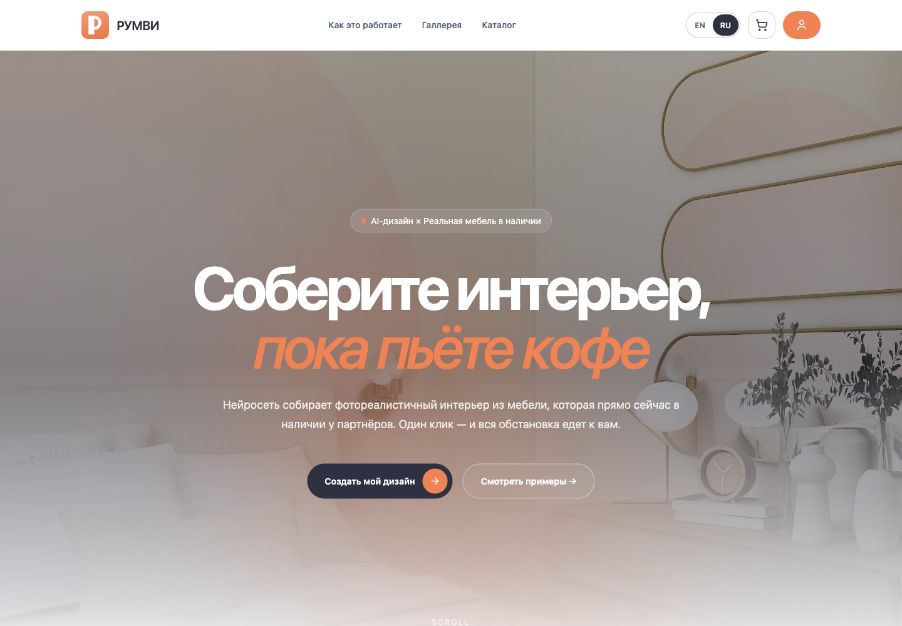
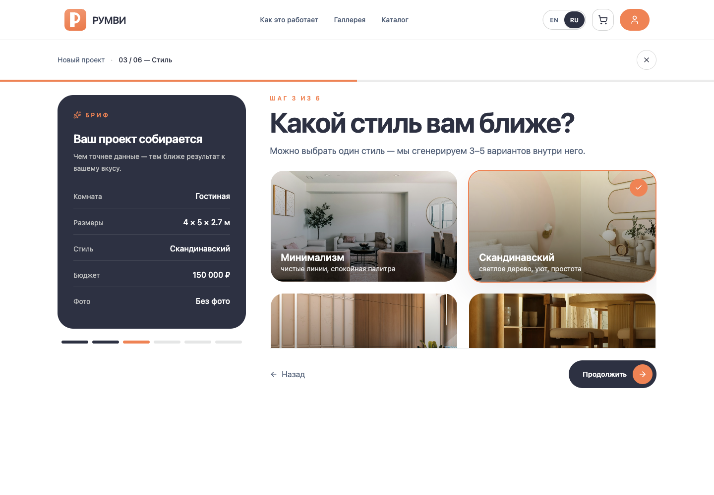
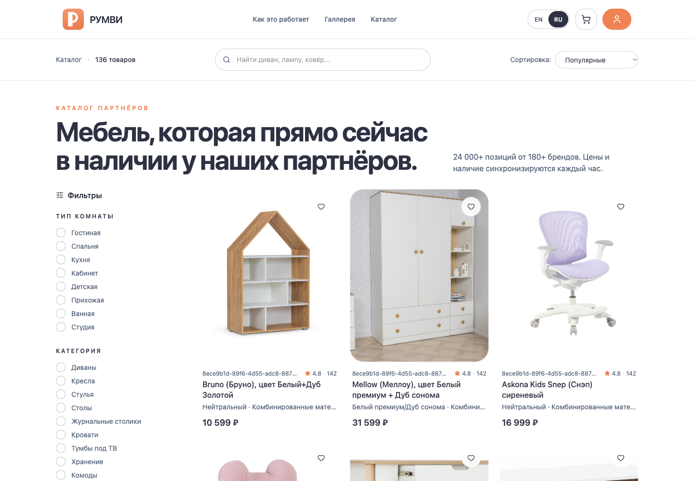
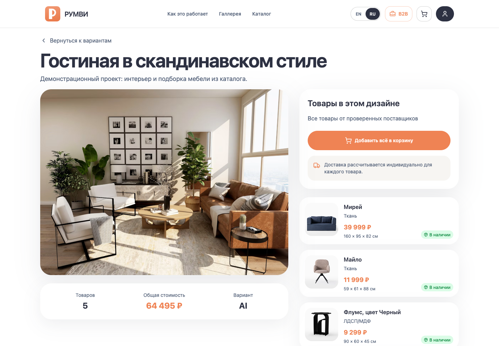
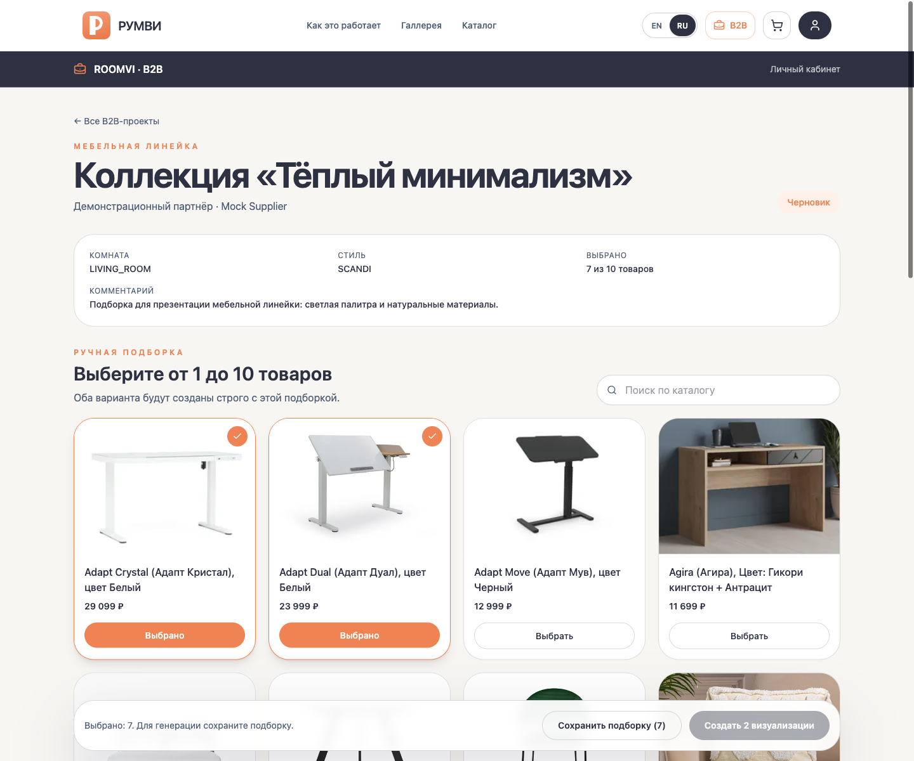
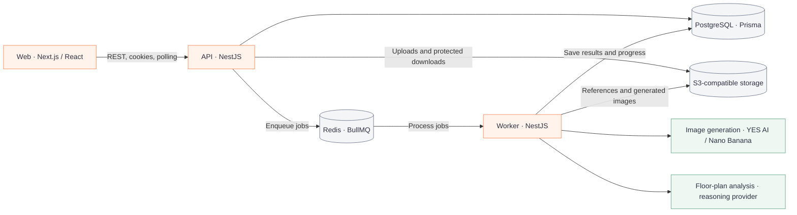

# Roomvi

**Русский** · [English](README.en.md)

Roomvi — платформа для создания интерьеров на основе реальных товаров мебельных поставщиков. Пользователь задаёт параметры комнаты, стиль и бюджет, получает варианты дизайна и может перейти от визуализации к выбору мебели и оформлению заказа.

Для работы с партнёрами предусмотрен внутренний B2B-кабинет: визуализация мебельных линеек и интерьеров по планировкам застройщиков.

## Возможности

- **Дизайн интерьера.** Параметры комнаты, фотография, стиль и бюджет; фоновая генерация нескольких вариантов с отображением прогресса.
- **Каталог мебели.** Товары поставщиков, фильтрация, карточки товаров и подбор мебели для интерьера.
- **Покупки.** Корзина, оформление заказа, история заказов и административное управление заказами.
- **Пользователи.** Регистрация, авторизация, гостевые сессии и разграничение доступа для клиентов, менеджеров и администраторов.
- **B2B: мебельные линейки.** Проекты партнёров, выбор товаров из каталога, генерация и скачивание визуализаций.
- **B2B: застройщики.** Загрузка растровой планировки, анализ помещений, проверка геометрии менеджером и генерация интерьеров комнат.

**Статус: проект закрыт, активная разработка прекращена.** Репозиторий сохраняет последнюю реализацию платформы. Промышленная синхронизация с поставщиками, эквайринг и логистика не были завершены.

## Интерфейс

Скриншоты работающего локального приложения. Каталог использует встроенные демонстрационные данные; дизайн и B2B-проект подготовлены для показа интерфейса. Изображение интерьера на экране дизайна — демонстрационный референс, а не результат нового вызова генерации.



| Создание интерьера: выбор стиля и бриф | Каталог мебели: поиск, фильтры и товары |
| --- | --- |
| [](assets/screenshots/02-design-wizard.png) | [](assets/screenshots/03-catalog.png) |
| **Дизайн: интерьер, товары и стоимость** | **B2B: проект партнёра и ручная подборка** |
| [](assets/screenshots/04-design-details.png) | [](assets/screenshots/05-b2b-workspace.png) |

## Технологии

| Область | Стек |
| --- | --- |
| Frontend | Next.js 16, React 19, TypeScript, Tailwind CSS 4 |
| Состояние и формы | TanStack Query, React Hook Form |
| Backend | NestJS 11, TypeScript |
| Данные | PostgreSQL 16, Prisma 6 |
| Фоновые задачи | Redis 7, BullMQ |
| Файлы | S3-совместимое хранилище; MinIO для локальной разработки |
| Генерация | Nano Banana через YES AI; тестовый провайдер `MOCK` |
| Тестирование | Vitest, Testing Library, Node.js Test Runner |
| Инструменты | npm workspaces, Turborepo, Docker Compose |

## Архитектура



API отвечает за бизнес-логику, права доступа и постановку задач в очередь. Отдельный worker обрабатывает генерацию, анализ планировок и сохранение результатов. Frontend взаимодействует с API через общий типизированный клиент.

```text
apps/
  web/          # Интерфейс: маркетплейс, личный кабинет, B2B
  api/          # HTTP API и бизнес-логика
  worker/       # Фоновые задачи и интеграции генерации
packages/
  database/     # Prisma-схема, миграции и клиент базы данных
  shared/       # Общие константы очередей и контракты
deploy/         # Конфигурация reverse proxy
```

## Локальный запуск

Понадобятся Node.js 22, npm 11 и Docker с Docker Compose. Команды выполняются из корня репозитория.

### 1. Установка и окружение

```bash
npm ci
cp .env.example .env
```

В `.env` находятся настройки PostgreSQL, Redis, сессий и хранилища. Задайте собственные значения `JWT_ACCESS_SECRET`, `JWT_REFRESH_SECRET` и `GUEST_HASH_SALT`.

Создайте файл `apps/web/.env.local`:

```dotenv
NEXT_PUBLIC_API_URL=http://localhost:4000
```

Next.js читает окружение из каталога `apps/web`; API и worker используют корневой `.env`.

### 2. Инфраструктура

```bash
npm run docker:up
```

Compose запустит PostgreSQL, Redis и MinIO. Откройте консоль MinIO на [localhost:9001](http://localhost:9001), войдите с локальными реквизитами из `docker-compose.yml` и создайте bucket `roomvi`. Настройки S3 в `.env.example` соответствуют этому локальному окружению. Для отображения загруженных изображений настройте чтение соответствующих объектов по `S3_PUBLIC_BASE_URL`.

### 3. База данных и приложения

После запуска PostgreSQL:

```bash
npm run db:generate
npm run db:migrate
npm run dev
```

Turborepo соберёт общие пакеты и запустит frontend, API и worker в режиме разработки.

| Сервис | Адрес |
| --- | --- |
| Web | [localhost:3000](http://localhost:3000) |
| API | [localhost:4000](http://localhost:4000) |
| Проверка API | [localhost:4000/health](http://localhost:4000/health) |
| MinIO API | [localhost:9000](http://localhost:9000) |
| MinIO Console | [localhost:9001](http://localhost:9001) |

Миграции создают структуру базы; каталог товаров и пользователи с ролями менеджера/администратора требуют отдельного наполнения.

### Провайдеры генерации

По умолчанию `GENERATION_PROVIDER=MOCK`: worker возвращает тестовые изображения без обращения к платному сервису генерации.

Для реальной генерации задайте `GENERATION_PROVIDER=NANO_BANANA` и параметры `YESAI_*` из `.env.production.example`. Внешнему провайдеру нужны доступные из интернета URL изображений; локальный MinIO по адресу `localhost` для этого не подходит.

Анализ планировок использует отдельную интеграцию с параметрами `REASONING_AI_*`. Ключи провайдеров задаются в серверном окружении.

## Команды

| Команда | Назначение |
| --- | --- |
| `npm run dev` | Все приложения в режиме разработки |
| `npm run build` | Сборка приложений и пакетов |
| `npm run typecheck` | Проверка TypeScript |
| `npm run lint` | ESLint для frontend |
| `npm test` | Тесты приложений |
| `npm run packages:build` | Сборка общих пакетов |
| `npm run db:generate` | Генерация Prisma Client |
| `npm run db:migrate` | Применение и создание миграций в разработке |
| `npm run db:studio` | Просмотр данных через Prisma Studio |
| `npm run docker:down` | Остановка локальной инфраструктуры |

API, worker и общие пакеты также можно запускать отдельно через npm workspaces: например, `npm run test -w worker` или `npm run dev -w web`.

## Развёртывание

Для серверного окружения предусмотрены `Dockerfile`, `docker-compose.prod.yml` и конфигурация Caddy в `deploy/`. Production Compose запускает web, API, worker, миграции, PostgreSQL, Redis и reverse proxy; S3-хранилище подключается отдельно.

Шаблон переменных — `.env.production.example`. Текущая конфигурация рассчитана на `roomvi.ru/release` с временной HTTP-авторизацией. При развёртывании на другом домене нужно согласовать настройки Caddy, CORS, публичного URL API и базового пути frontend.
